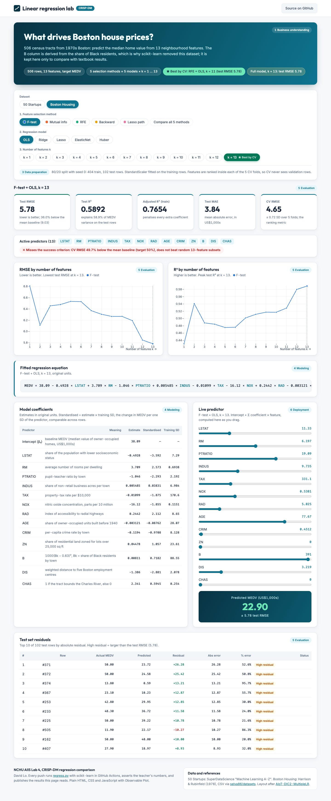

# AIIS Lab 4 — 線性迴歸實驗儀表板（CRISP-DM）

單頁的實驗儀表板，在 **50 Startups** 與 **Boston Housing** 兩份資料上比較
**5 種特徵選擇方法 × 5 種線性迴歸模型 × 每一個特徵數 k**，訓練 / 測試 = 80 / 20。
選一種方法（或五種一起比較）、一個模型、一個 k，底下每一張卡片都會跟著更新。

- 網站：<https://davidlo3917.github.io/AIoT-DIC-L4/>
- 版面參考 [AIoT-DIC2-MultipleLR](https://huanchen1107.github.io/AIoT-DIC2-MultipleLR/)；
  F-test + OLS、k = 2 的數字和該頁一致（測試 RMSE 8,198.80、R² 0.9474）
- 上週的單檔練習（backward elimination、重現老師的表格）移到 [`lab/`](lab/)




## 比較了什麼

| | 項目 |
|---|---|
| 特徵選擇 | F 檢定（`f_regression`）、互資訊、RFE、逐步後退（依 CV R²）、Lasso 路徑（進入順序） |
| 迴歸模型 | OLS、Ridge、Lasso、ElasticNet、Huber（Ridge / Lasso / ElasticNet 的 α 用訓練集 CV 調） |
| 特徵數 | 每個 k = 1 … p 都跑；網頁標出每種方法 CV RMSE 最低的 k，以及 k = p 的完整模型 |
| 基準 | 直接預測訓練集平均值；隨機挑 k 個特徵（OLS）；老師的表格（CI 自動檢查） |

**最佳 k 依 CV RMSE（訓練集 5 折）決定，卡片上報告的是測試集分數。**
50 Startups 的測試集只有 10 筆，若依測試 RMSE 挑 k，等於拿測試集來選模型，分數會偏樂觀。
特徵選擇在每一個 CV fold 裡重做，CV 分數不會偷看驗證資料。

## 網頁上的 CRISP-DM

| 階段 | 位置 |
|---|---|
| 1 商業理解 | 開場卡：問題、預測目標、實驗設定（Boston：B 欄的倫理說明） |
| 2 資料理解 | 開場卡的標籤：筆數、特徵數、目標、最佳組合、完整模型分數 |
| 3 資料準備 | 控制列下方一行：one-hot（刪第一類）、80/20 切分（seed 0）、以訓練集做 StandardScaler、在 CV fold 內做特徵選擇 |
| 4 建模 | 控制列（方法、模型、k）、迴歸式、係數表（含標準化係數與欄位說明） |
| 5 評估 | 指標卡、成功標準、RMSE 與 R² 對 k、測試集殘差表 |
| 6 部署 | 即時預測：拖動滑桿，在瀏覽器裡直接代入迴歸式 |

成功標準：目前組合的 CV RMSE 比預測平均值低 50% 以上，而且勝過隨機挑同樣數量的特徵。

## 結果摘要（random_state = 0）

| | 50 Startups | Boston Housing |
|---|---|---|
| CV 最佳 | F 檢定 k = 2 + Huber，CV RMSE 9,304，測試 R² 0.947 | RFE k = 11 + OLS，CV RMSE 4.61，測試 R² 0.590 |
| 測試最佳 | F 檢定 k = 2 + Lasso，測試 RMSE 8,199 | Lasso 路徑 k = 12 + OLS，測試 RMSE 5.78 |
| 預測平均值（測試 RMSE） | 37,994 | 9.03 |
| 結論 | 只要 R&D Spend + Marketing Spend；五種方法在每個 k 選的特徵幾乎相同，「一起比較」時線會重疊。州別沒有訊號 | 方法之間差異較大；LSTAT、RM 在每種方法都排前兩名。教科書常見的 R² 0.74 是「全資料、樣本內」，測試集只有 0.59 |

老師表格的第 1、2、All 列（8274.868018 / 8198.797191 / 9137.990153）由 `regress.py` 在每次建置時自動檢查。

## 檔案

```text
web/index.html   頁面骨架（卡片堆疊）
web/style.css    樣式
web/app.js       狀態、控制列、圖表（Observable Plot）
web/regress.py   分析程式；產生 web/data/*.json 並執行檢查
web/data/        兩份 CSV；*.json 由 regress.py 產生（不進版控）
lab/             上週的單檔練習
.github/workflows/pages.yml   推送到 main → 跑 regress.py → 部署 GitHub Pages
```

沒有建置步驟、沒有 npm：圖表庫 Observable Plot 0.6.17 從 jsDelivr 載入。

## 在本機執行

需要 [uv](https://docs.astral.sh/uv/)。先產生結果檔，再開本機伺服器：

```bash
uv run --python 3.14 --with scikit-learn==1.8.0 --with pandas==3.0.2 --with numpy==2.4.6 --with scipy==1.18.0 python web/regress.py
python3 -m http.server 8000 -d web   # 開 http://localhost:8000
```

## 部署

推送到 `main` 時 GitHub Actions 會執行 `regress.py`（老師數字的檢查沒過就不會部署），再把 `web/` 部署到 GitHub Pages。

## 資料來源

- 50 Startups：SuperDataScience《Machine Learning A-Z》課程資料（與 `lab/` 使用同一份）
- Boston Housing：Harrison & Rubinfeld (1978)，CSV 取自 [selva86/datasets](https://github.com/selva86/datasets)。
  scikit-learn 1.2 起移除了這份資料，因為 B 欄由黑人居民比例換算而來；這裡保留它是為了和教科書結果對照，網頁上也有說明。
