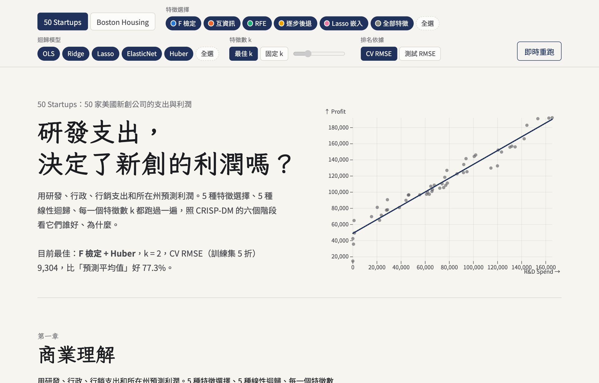
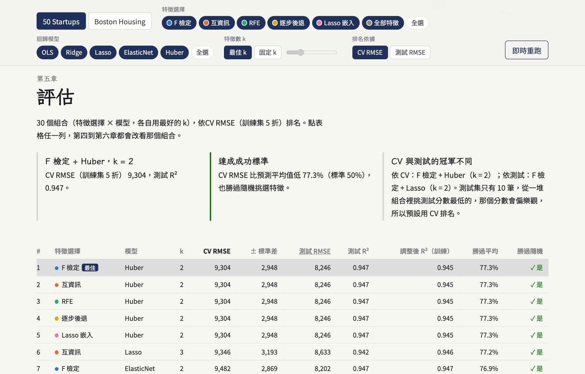

# AIIS Lab 4 — 多元線性迴歸實驗筆記（CRISP-DM）

照 CRISP-DM 的六個階段，在 **50 Startups** 與 **Boston Housing** 兩份資料上比較
**5 種特徵選擇 × 5 種線性迴歸 × 每一個特徵數 k**，訓練 / 測試 = 80 / 20。
網頁可以自由勾選方法與模型（或全選）互相比較，也能在瀏覽器裡用 Pyodide 即時重跑。

- 網站：<https://davidlo3917.github.io/AIoT-DIC-L4/>
- 上週的單檔練習（backward elimination、重現老師的表格）移到 [`lab/`](lab/)





## 比較了什麼

| | 項目 |
|---|---|
| 特徵選擇 | F 檢定（SelectKBest / `f_regression`）、互資訊（`mutual_info_regression`）、RFE、逐步後退（backward，依 CV R²）、Lasso 嵌入（Lasso 路徑上進入的順序），外加「全部特徵」當基準 |
| 迴歸模型 | OLS、Ridge、Lasso、ElasticNet、Huber（Ridge / Lasso / ElasticNet 的 α 用訓練集 CV 調） |
| 特徵數 | 每個 k = 1 … p 都跑；網頁可選「各自最佳 k」或固定 k |
| 基準 | 直接預測訓練集平均值；隨機挑 k 個特徵（OLS）的 p10–p90；老師的表格 |

**排名預設用 CV RMSE（訓練集 5 折），測試 RMSE 放在旁邊、可切換。**
50 Startups 的測試集只有 10 筆：從 130 個組合裡挑測試分數最低的，等於拿測試集來選模型，那個分數會偏樂觀。
所以用 CV 挑、用測試集報告；網頁第五章會同時列出兩種排名的冠軍。

特徵選擇在每一個 CV fold 裡重做，CV 分數不會偷看驗證資料。

## 網頁的六章

| CRISP-DM | 內容 |
|---|---|
| 商業理解 | 問題、預測目標、成功標準（CV RMSE 比預測平均值低 50% 以上，且勝過隨機特徵）、欄位說明；Boston 的倫理說明（B 欄） |
| 資料理解 | 資料品質、目標分布、相關係數熱圖、每個特徵 vs 目標的散佈圖、敘述統計 |
| 資料準備 | One-hot encoding 前後對照（虛擬變數陷阱）、80/20 切分、標準化 |
| 建模 | 每種方法的特徵排序矩陣、同一組特徵下各模型的標準化係數、迴歸式、Ridge / Lasso / ElasticNet 正則化路徑 |
| 評估 | 排行榜、方法 × 模型熱圖、RMSE vs k（含隨機特徵帶）、實際 vs 預測與殘差、和老師結果對照 |
| 部署 | 用選中的模型即時預測（滑桿輸入特徵） |

**即時重跑**：右上角按鈕。用 Pyodide 在瀏覽器裡執行同一份 `regress.py`，可以改亂數種子、CV 折數、各模型的 α / l1_ratio / Huber ε、
是否 drop-first、是否標準化，以及 Boston 是否刪掉 B 欄與房價 = 50 的列。第一次要下載約 31 MB；50 Startups 約 2 秒、Boston 約 5 秒。

## 結果摘要（random_state = 0）

| | 50 Startups | Boston Housing |
|---|---|---|
| CV 最佳 | F 檢定 k = 2 + Huber，CV RMSE 9,304，測試 R² 0.947 | RFE k = 11 + OLS，CV RMSE 4.61，測試 R² 0.590 |
| 預測平均值（測試 RMSE） | 37,994 | 9.03 |
| 結論 | 只要 R&D Spend + Marketing Spend；5 種方法選的完全一樣。州別沒有訊號 | 方法之間差異較大；LSTAT、RM 永遠排前兩名。教科書常見的 R² 0.74 是「全資料、樣本內」，測試集只有 0.59 |

老師表格的第 1、2、All 列（8274.868018 / 8198.797191 / 9137.990153）由 `regress.py` 在每次建置時自動檢查。

## 檔案

```text
web/index.html   頁面骨架（六章）
web/style.css    樣式（淺色 / 深色跟著系統）
web/app.js       互動與圖表（Observable Plot）
web/worker.js    即時重跑：Pyodide 載入 regress.py
web/regress.py   分析程式；CI 和瀏覽器共用同一份
web/data/        兩份 CSV；*.json 由 regress.py 產生（不進版控）
lab/             上週的單檔練習
.github/workflows/pages.yml   推送到 main → 跑 regress.py → 部署 GitHub Pages
```

沒有建置步驟、沒有 npm：圖表庫（Observable Plot 0.6.17）與 Pyodide 314.0.7 從 jsDelivr 載入。

## 在本機執行

需要 [uv](https://docs.astral.sh/uv/)。先產生結果檔，再開本機伺服器：

```bash
uv run --python 3.14 --with scikit-learn==1.8.0 --with pandas==3.0.2 --with numpy==2.4.6 --with scipy==1.18.0 python web/regress.py
python3 -m http.server 8000 -d web   # 開 http://localhost:8000
```

Python 套件版本和瀏覽器裡的 Pyodide 一致，兩邊算出的數字相同（實測差距 < 1e-12）。

## 部署

推送到 `main` 時 GitHub Actions 會執行 `regress.py`（老師數字的檢查沒過就不會部署），再把 `web/` 部署到 GitHub Pages。

## 資料來源

- 50 Startups：SuperDataScience《Machine Learning A-Z》課程資料（與 `lab/` 使用同一份）
- Boston Housing：Harrison & Rubinfeld (1978)，CSV 取自 [selva86/datasets](https://github.com/selva86/datasets)。
  scikit-learn 1.2 起移除了這份資料，因為 B 欄由黑人居民比例換算而來；這裡保留它是為了和教科書結果對照，網頁上有說明，也可以在即時重跑時刪掉。
