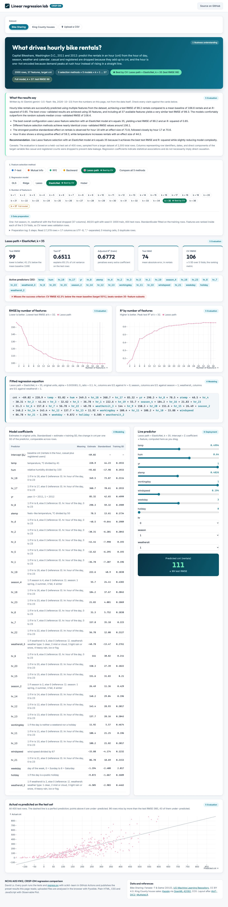
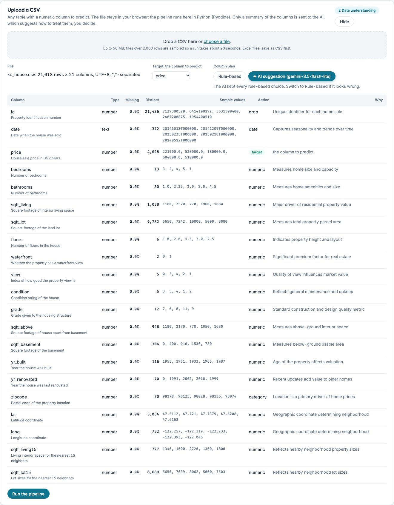
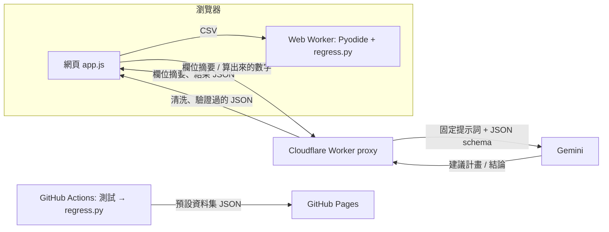

# AIIS HW2 — 任意 CSV 的線性迴歸實驗儀表板（CRISP-DM + AI）

單頁的實驗儀表板：使用者上傳一份 CSV，網頁在**瀏覽器裡用 Python（Pyodide）**比較
**5 種特徵選擇方法 × 5 種線性迴歸模型 × 每一個特徵數 k**（訓練 / 測試 = 80 / 20，5 折 CV），
Gemini 負責兩件事：建議每個欄位的處理方式（經驗證後才採用），以及根據算出來的數字撰寫結論。
預設放了兩份資料集：**Bike Sharing**（每小時租借量）與 **King County 房價**。

- 網站：<https://davidlo3917.github.io/AIoT-DIC-HW2/>
- 上傳的檔案不會離開瀏覽器；送到 AI 的只有欄位摘要與計算結果（見[AI 的角色與防護](#ai-的角色與防護)）





## 系統如何運作



CSV 寫進 Pyodide 的虛擬檔案系統，`regress.py` 在 Web Worker 裡執行整條流程。
離開瀏覽器的只有欄位摘要與計算結果，兩者都經過 Cloudflare Worker，由它持有提示詞與金鑰、限制來源與頻率。

### 哪些事交給程式，哪些事交給 AI

| 工作 | 執行者 | 原因 |
|---|---|---|
| 讀檔、欄位摘要、型別與缺值處理、洩漏與共線偵測、80/20 切分、5 折 CV、5 × 5 種組合 × 每個 k 的配適、所有指標與基準 | `regress.py`：確定性程式，瀏覽器裡的 scikit-learn | 數字必須可重現、可驗證：CI 每次建置都跑測試，瀏覽器與 CI 算出同樣的結果 |
| 判讀欄位語意：標籤或數量、哪些欄洩漏目標、預測哪一欄、欄位說明、資料集標題 | Gemini 建議 → `check_plan()` 驗證 → 使用者可切回規則版或改目標欄 | 規則無法判讀語意（hr 是時段、casual + registered = cnt）；AI 只能建議，不能執行 |
| 撰寫結論：摘要、3–5 個發現、建議、注意事項 | Gemini，輸入只有計算結果與準備紀錄 | 數字由程式計算，AI 只負責敘述；網頁標示為 AI 產生 |

## 上傳流程

1. 按 **Upload a CSV**（或把檔案拖進面板）。瀏覽器開始下載 Pyodide 與 scikit-learn（約 40 MB，第一次約 10 秒，之後有快取）。
2. 檔案寫進 Pyodide 的虛擬檔案系統，`regress.py` 的 `profile()` 做每欄摘要，規則給出預設計畫：
   目標欄（照常見欄名猜，沒有就取最後一個數值欄）與每欄的動作 `numeric` / `category` / `date` / `extract-number` / `drop`。
3. 同一時間，**欄位摘要**（欄名、型別、缺值比例、5 個樣本值、規則版動作）送到代理，Gemini 回傳建議計畫、欄位說明、標題與摘要句。
   AI 改動的列會標色；可切回規則版，目標欄可自行選擇。AI 沒有回應時使用規則版。
4. **Run the pipeline**：進度條顯示配了幾個模型；可以取消。結果變成一個新的資料集分頁，只存在記憶體裡。
5. 完成後，**計算結果**（最佳組合、各方法與各模型的最佳、標準化效果、基準、準備紀錄）送給 Gemini 撰寫結論，
   顯示在開場卡下方的「What the results say」，並標示為 AI 產生。
6. 控制列下方的「Preparation log」列出資料準備的每一步：抽樣、刪掉哪些欄、為什麼、類別怎麼合併、缺值怎麼補。

## 資料處理

`read()` → `profile()` → `check_plan()` → `prepare()` → `screen()` 各負責一層檢查；每個決定都寫進準備紀錄，錯誤訊息直接顯示給使用者。

| 狀況 | 處理 |
|---|---|
| 編碼、分隔符號 | UTF-8（含 BOM）或 Windows-1252；`,` `;` tab `\|` 自動偵測；`;` 分隔視為小數逗號 |
| Excel、空檔、單欄、超過 50 MB | 拒收，說明原因 |
| 數字存成文字 | `$1,200`、`45%`、`1.234,5` → 數字；`8GB`、`1.37kg` → 取出數字（`extract-number`） |
| 日期 | 拆成年、月 |
| ID、列號、常數欄、自由文字、缺值超過一半 | 預設 `drop` |
| 類別欄 | 預設保留最常見的 9 類，其餘併為 Other；缺值自成一類 Missing；郵遞區號雖是數字仍當類別 |
| 目標欄 | 必須是數值且超過 2 個不同值；沒有目標值的列刪除；少於 30 列拒收 |
| 洩漏 | 與目標相關 > 0.98、或幾個欄位一起幾乎完美重現目標（Bike 的 casual + registered = cnt）→ 刪除並說明 |
| 共線 | 可由其他欄線性組合出的欄（King County 的 sqft_above）→ 刪除 |
| 規模 | 超過 2,000 列隨機抽樣；特徵上限 40（超過就先縮減類別數）；訓練列數要 ≥ 2p + 10 |
| 來路不明的計畫 | AI 或使用者給的計畫一律經 `check_plan()`：欄名要存在、動作要合法，其餘補預設 |
| 單一模型失敗 | 該格改用平均值並標記 `failed`，不拖垮整個網格 |

`tests/test_regress.py` 有 17 個測試涵蓋以上情況，並以 50 Startups 的已知 OLS 數字檢查模型網格；CI 每次建置都跑。

## 效能

目標是一次分析在 20 秒上下。Chrome 實測：2,000 列 × 37 特徵約 16–23 秒，另加第一次下載 Pyodide 約 10 秒。
`regress.py` 的加速方式（都有測試或比對證明結果不變）：

- OLS 用 Gram 矩陣一次算好，每組特徵只解一個 (k+1)×(k+1) 系統
- Ridge 用閉式留一誤差自己選 α（測試證明與 `RidgeCV` 同解）
- Lasso / ElasticNet 的 α 每個 fold 用全部特徵調一次、所有 k 共用（p = 30 實測 CV RMSE 中位數 +0.5%），網格內用 `precompute=True`
- Huber 從上一個 k 的解暖啟動
- 不同方法選到同一組特徵時只配一次

## AI 的角色與防護

AI 只做建議與敘述，不計算任何數字、不執行任何程式。兩個端點都在 `proxy/worker.mjs`（Cloudflare Worker，持有提示詞與金鑰）：

| | `POST /plan` | `POST /summary` |
|---|---|---|
| 輸入 | 欄位摘要（不含資料列） | 計算結果與準備紀錄 |
| 輸出 | 目標欄、每欄動作與理由、欄位說明、標題 | 摘要、3–5 個發現、建議、注意事項 |

防護（`proxy/worker.test.mjs` 用假的 Gemini 測 8 個情境）：

- 提示詞由 Worker 持有，頁面送來的只被當成資料；多餘的欄位一律丟掉
- 輸出用 JSON schema 限制；`/plan` 用每次請求的代號 `c0…cN` 指稱欄位，模型從不回傳欄名
- 回傳文字全部清洗：去掉 HTML 括號、連結、控制字元，長度上限；計畫再經 Python `check_plan()` 驗證
- 來源白名單（`ALLOWED_ORIGINS`）、每個 IP 每分鐘 10 次、64 KB / 100 欄上限
- 模型：`gemini-3.5-flash`，過載或逾時就換 `gemini-3.5-flash-lite`；實測 `/plan` 6–21 秒、`/summary` 6–13 秒
- 網頁上所有 AI 寫的文字都標示為 AI 產生；AI 不可用時規則版照常運作

預設資料集的結論只產生一次（`python web/regress.py summaries`），存在 `web/summaries.json`，之後每次建置沿用，訪客不會觸發 AI 呼叫。

限制：

- 結論可能引用錯誤的數字；結論卡片因此註明請對照下方卡片，預設資料集的結論經人工檢查
- AI 的計畫是建議，不一定是最佳選擇（例如 Bike 的 hr 只保留 9 個最常見時段，預設計畫保留 24 個）
- 送到 Google 的是欄名、每欄 5 個樣本值與計算結果；免費方案的提示可能被用於改善模型，請勿上傳含個資或機密的檔案
- Origin 標頭可以偽造；每 IP 每分鐘 10 次與免費額度是最後的防線

## 網頁上的 CRISP-DM

| 階段 | 位置 |
|---|---|
| 1 商業理解 | 開場卡：問題、預測目標、實驗設定（AI 寫的標題與摘要會標示） |
| 2 資料理解 | 上傳面板：每欄的型別、缺值、不同值數、樣本、規則版與 AI 版計畫 |
| 3 資料準備 | 控制列下方：one-hot（刪第一類）、80/20 切分、訓練集 StandardScaler、fold 內特徵選擇；展開 Preparation log 看每一步 |
| 4 建模 | 控制列（方法、模型、k）、迴歸式、係數表（含標準化係數與欄位說明） |
| 5 評估 | AI 結論、指標卡、成功標準、RMSE 與 R² 對 k、測試集殘差表 |
| 6 部署 | 即時預測：拖動滑桿、選類別，在瀏覽器裡直接代入迴歸式 |

成功標準：目前組合的 CV RMSE 比預測平均值低 50% 以上，而且勝過隨機挑同樣數量的特徵。
最佳 k 依 CV RMSE（訓練集 5 折）決定，卡片上報告的是測試集分數；特徵選擇在每一個 fold 裡重做。

## 預設資料集的結果（seed 0，各抽 2,000 列）

| | Bike Sharing | King County 房價 |
|---|---|---|
| 資料 | 17,379 列 × 17 欄 → 37 個特徵（hr、season、weathersit one-hot） | 21,613 列 × 21 欄 → 37 個特徵（date 拆年月、zipcode 前 19 類） |
| 自動刪掉 | instant（列號）、dteday（與 yr/mnth/weekday 重複）、casual 與 registered（加起來就是 cnt） | id、sqft_above（= sqft_living − sqft_basement） |
| CV 最佳 | Lasso 路徑 k = 35 + ElasticNet，CV RMSE 106 | Lasso 路徑 k = 35 + ElasticNet，CV RMSE 190,889 |
| 測試集 | RMSE 99.2 輛，R² 0.651 | RMSE US$183,540，R² 0.736 |
| 完整模型（k = 37，OLS） | RMSE 99.3 | RMSE US$183,623 |
| 預測平均值（測試 RMSE） | 168.6 | 357,147 |
| 最大的標準化效果 | hr_18 +73.9、hr_17 +70.6、hr_8 +59.3、temp +44.2、yr +42.6 | sqft_living +134k、grade +115k、lat +87k、zipcode Other −66k、yr_built −58k |
| 結論 | 上下班尖峰時段主導；五種方法最佳 k 都在 35–37，彼此差不到 0.1 | 坪數、建築等級、緯度（越北越貴）；五種方法最佳 k 同樣落在 35–37 |

## 檔案

```text
web/index.html      頁面骨架（卡片堆疊，含上傳面板與 AI 結論卡）
web/style.css       樣式
web/app.js          狀態、控制列、圖表（Observable Plot）、上傳流程、與代理的兩個呼叫
web/worker.js       Web Worker：載入 Pyodide 與 regress.py，回報進度
web/regress.py      分析程式：讀檔、欄位計畫、準備、模型網格；也產生預設資料集的 JSON
web/presets.json    兩份預設資料集的計畫與說明文字
web/summaries.json  預設資料集的 AI 結論（產生一次）
web/data/           兩份 CSV；*.json 由 regress.py 產生（不進版控）
proxy/worker.mjs    Gemini 代理（Cloudflare Worker）與 wrangler.toml、離線測試
tests/              資料處理的測試與 50 Startups 的已知數字
.github/workflows/pages.yml   推送到 main → 測試 → regress.py → 部署 GitHub Pages
```

沒有建置步驟、沒有 npm：Observable Plot 0.6.17 與 Pyodide 314.0.7 都從 jsDelivr 載入；
`regress.py` 的套件版本釘在 Pyodide 內建的版本（scikit-learn 1.8.0、pandas 3.0.2、numpy 2.4.6、scipy 1.18.0），
所以 CI、本機與瀏覽器算出同樣的數字（實測相對差 < 1e-12）。

## 在本機執行

需要 [uv](https://docs.astral.sh/uv/)；代理需要 Node 22 與一把 Gemini API key（放在 `proxy/.dev.vars`：`GEMINI_KEY=...`，已被 git 忽略）。

```bash
R="uv run --python 3.14 --with scikit-learn==1.8.0 --with pandas==3.0.2 --with numpy==2.4.6 --with scipy==1.18.0 python"
$R tests/test_regress.py                 # 17 個測試，約 15 秒
$R web/regress.py                        # 產生 web/data/{bike,kc}.json，約 20 秒
node proxy/worker.test.mjs               # 代理的 8 個離線測試
python3 -m http.server 8000 -d web       # 開 http://localhost:8000（代理只放行 localhost:8000）
cd proxy && npx wrangler@4 dev --port 8787 --ip 127.0.0.1   # 本機代理
$R web/regress.py summaries              # （選用）重新產生預設資料集的 AI 結論
```

沒開代理也能用：上傳流程會顯示「AI unavailable」並改用規則版計畫。

## 部署

- 網頁：推送到 `main`，GitHub Actions 先跑測試與代理測試，再執行 `regress.py` 產生結果檔，最後把 `web/` 部署到 GitHub Pages。
- 代理：在 `proxy/` 執行 `npx wrangler@4 deploy` 與 `npx wrangler@4 secret put GEMINI_KEY`，
  把得到的 `*.workers.dev` 網址填進 `web/app.js` 的 `PROXY`。允許的來源寫在 `proxy/wrangler.toml`。

## 資料來源

- Bike Sharing：Fanaee-T, H. & Gama, J. (2013). *Event labeling combining ensemble detectors and background knowledge.* Progress in Artificial Intelligence.
  取自 [UCI Machine Learning Repository](https://archive.ics.uci.edu/dataset/275/bike+sharing+dataset)，CC BY 4.0。
- King County 房價：[Kaggle](https://www.kaggle.com/datasets/harlfoxem/housesalesprediction)，透過 [OpenML 42092](https://www.openml.org/d/42092) 下載，CC0。
- 50 Startups（`tests/` 的測試資料）：SuperDataScience《Machine Learning A-Z》課程資料。
- 版面參考 [AIoT-DIC2-MultipleLR](https://huanchen1107.github.io/AIoT-DIC2-MultipleLR/)。
