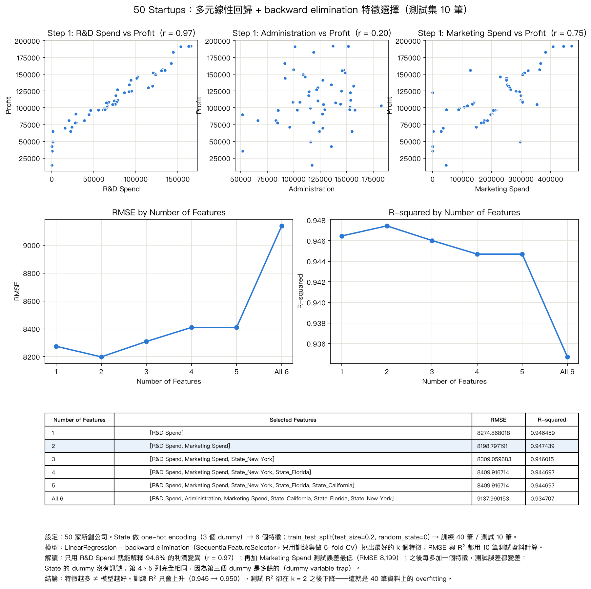

# AIIS Lab 4 — 50 Startups 多元線性回歸（Multiple Linear Regression）

用 scikit-learn 分析 Kaggle 的 50_Startups 資料集：以研發、行政、行銷支出與所在州預測利潤，
照 CRISP-DM 的步驟（載入資料與散佈圖 → one-hot encoding / train-test split → LinearRegression + backward elimination 特徵選擇 → MSE / RMSE / MAE / R² 評估），
重現「特徵數 vs RMSE / R²」的結果，並解讀老師想教的觀念。

- 程式碼：<https://github.com/davidlo3917/AIoT-DIC-L4>

## 檔案

| 檔案 | 內容 |
|---|---|
| `startup50_regression.py` | 分析程式。直接從網址讀取 CSV，印出資料摘要、係數與結果表格，並輸出總覽圖 |
| `startup50_results.png` | 程式輸出的總覽圖：Step 1 散佈圖、RMSE / R² 折線圖、結果表格、一段說明 |

## 執行方式

有 [uv](https://docs.astral.sh/uv/) 的話一行搞定，相依套件會自動安裝：

```bash
uv run startup50_regression.py
```

沒有 uv：

```bash
pip install pandas scikit-learn matplotlib
python startup50_regression.py
```

執行需要網路（CSV 從 gist 網址讀取）。程式會在終端機印出表格、把總覽圖存成 `startup50_results.png`，再開一個視窗顯示；關掉視窗程式就結束。
測試環境：Python 3.12、scikit-learn 1.9.1、pandas 3.0.6、matplotlib 3.11。

## 結果摘要（測試集 10 筆，`random_state=0`）



| Number of Features | Selected Features | RMSE | R-squared |
|---|---|---|---|
| 1 | R&D Spend | 8274.868018 | 0.946459 |
| **2** | **R&D Spend, Marketing Spend** | **8198.797191** | **0.947439** |
| 3 | + State_New York | 8309.059683 | 0.946015 |
| 4 | + State_Florida | 8409.916714 | 0.944697 |
| 5 | + State_California | 8409.916714 | 0.944697 |
| All 6 | + Administration | 9137.990153 | 0.934707 |

- 只用 R&D Spend 就能解釋 94.6% 的利潤變異；加 Marketing Spend 後測試誤差最低；再加州別、Administration 只會變差——特徵越多 ≠ 模型越好。
- 第 4、5 列相同：第三個 State dummy 是多餘的（dummy variable trap）。
- 「All 6」就是老師表格第 5 列的數字（9137.99 / 0.934707）：那一列實際上是含 Administration 的全特徵模型。程式內建 `assert` 驗證這六個 RMSE。
